# ML Project

## Создание окружения и активация скриптов
python -m venv .venv

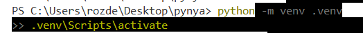

python
.venv\Scripts\activate

слева от пути к директории в консоли будет отображаться (.venv), что значт, что окружение создано

## Обновление инструментов сборки

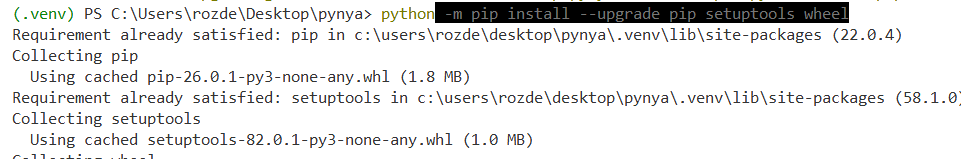

python -m pip install --upgrade pip setuptools wheel


## Установка uv для более быстрой загрузки пакетов
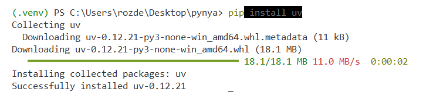


## Установка зависимостей из заранее заготовленных файлов в папке requirements
uv pip install -r requirements/requirements_ML.txt
uv pip install -r requirements/requirements_service.txt
uv pip install -r requirements/requirements_jupyter.txt

запустится установка


после установки можно проверить
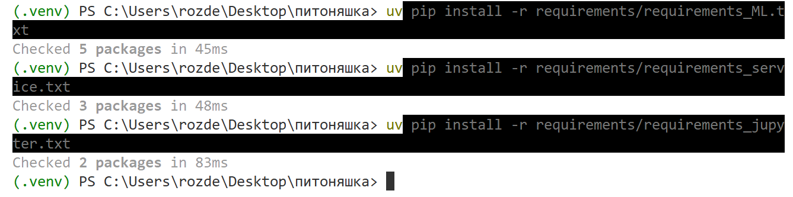

## Запуск приложения FastAPI
приложение:

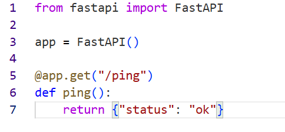

запуск:


результат:

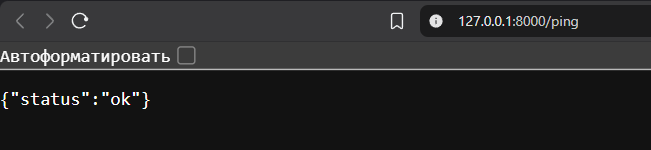

по адресу http://127.0.0.1:8000/docs доступна документация FastAPI

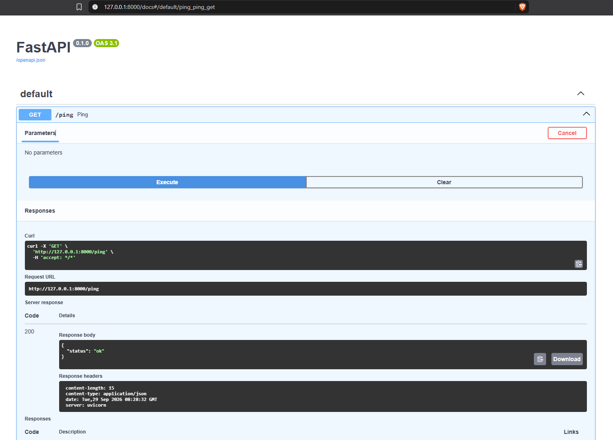

## pyproject.toml

`pyproject.toml` — это стандартный файл конфигурации для Python-проектов, который пришёл на смену setup.py и requirements.txt . Он позволяет централизованно управлять зависимостями, метаданными проекта и настройками инструментов разработки 


Базовая структура toml:
```
[build-system]
requires = ["setuptools>=61.0"]
build-backend = "setuptools.build_meta"

[project]
name = "my-package"
version = "0.1.0"
description = "Пример проекта"
requires-python = ">=3.9"
dependencies = [
    "requests>=2.28",
    "rich",
]

[project.optional-dependencies]
dev = ["pytest", "black"]
```


`build-system`: Указывает, какие инструменты нужны для сборки пакета (например, setuptools, hatchling, flit или uv) . Это позволяет pip понимать, как устанавливать проект из исходников.

`project`: Основная секция с метаданными. Обязательные поля — name и version . Сюда же добавляются описание, авторы, лицензия, ссылки и т.д. .

`dependencies`: Список пакетов, необходимых для работы кода. Можно указывать версии (например, requests>=2.28).

`project.optional-dependencies`: Дополнительные зависимости, которые нужны не всем. Например, инструменты для разработки (dev) или поддержка GUI (gui) . Устанавливаются командой вида pip install my-package[dev].

### Установка пакетов

`pip install ".[dev]"`

## Установка пакетов с помощью toml

Синтаксис pip install my-package[dev] и опциональные зависимости (extras) — это одно и то же. Это не два разных подхода, а просто разные названия и способы записи одной и той же концепции.

Extras — это механизм, который позволяет объявить в проекте группы зависимостей, нужные не всем, а только для определённых сценариев (например, для разработки, тестирования или поддержки дополнительных функций)


pip install my-package[ml]: устанавливается готовый пакет из PyPI (или другого индекса) и pip доустанавливает его опциональные зависимости.

uv pip install -r pyproject.toml --extra ml: устанавливаются зависимости из локального файла проекта pyproject.toml. В этом случае uv нужно явно указать, что мы хотим взять не только основные зависимости (project.dependencies), но и конкретную группу из optional-dependencies. Для этого и используется флаг --extra.

По сути, --extra ml — это локальный аналог квадратных скобок [ml], но для файла проекта, а не для имени опубликованного пакета.


Удаление установленных пакетов:

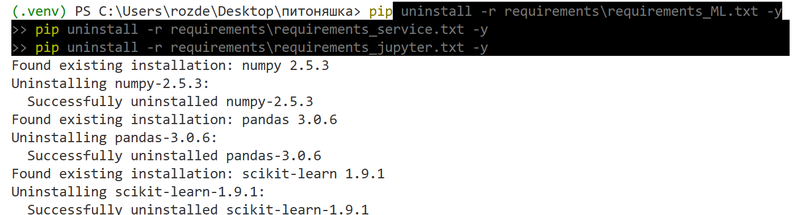


Структура устанавливаемого toml:

```[build-system]
requires = ["setuptools>=61.0"]
build-backend = "setuptools.build_meta"

[project]
name = "my-project"
version = "0.1.0"
description = "Проект с ML"
authors = ["Волосикова Мария"]
requires-python = ">=3.9"
dependencies = []          # базовых зависимостей нет — всё опционально


[tool.setuptools.packages.find]
exclude = ["images*", "app*", "perceptron*"]


[project.optional-dependencies]
ml = [
    "numpy",
    "pandas",
    "scikit-learn",
    "seaborn",
    "plotly",
]
service = [
    "fastapi",
    "uvicorn[standard]",
    "gradio",
]
jupyter = [
    "jupyter",
    "ipython",
]
all = [
    "numpy",
    "pandas",
    "scikit-learn",
    "seaborn",
    "plotly",
    "fastapi",
    "uvicorn[standard]",
    "gradio",
    "jupyter",
    "ipython",
]
```
в all перечислены все пакеты, чтобы можно было установить все сразу.


Установка с помощью pyproject.toml:

При установке в пути к директории не должно быть кириллическоих символов!

Если pip не может запустить установку toml из переименованного файла, то необходимо полностью переустановить окружение:

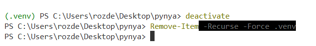

Деактивация скриптов и удаление .venv

Также необходимо в самом файле toml явно указать, чтобы директории не рассматривались как пакеты при автоматическом обнаружении. Такой способ отключает автоматическое обнаружение:

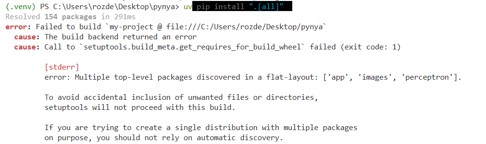


Установка пакетов через toml и uv:

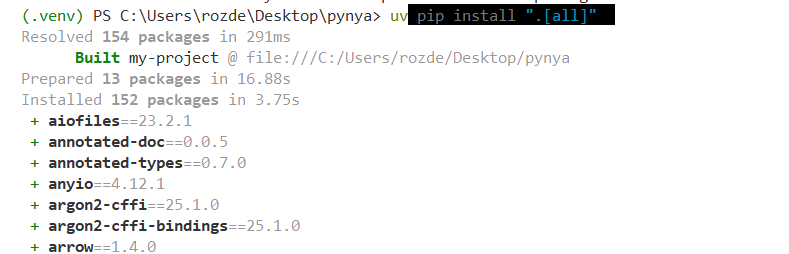

## Проверка установки:

Команда uv pip list показывает список всех установленных пакетов:/

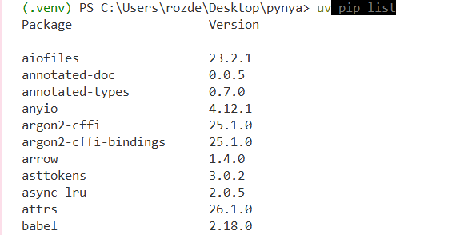

# С помощью uv можно сделать toml и venv автоматически 

Самый простой путь — использовать uv init. Эта команда создаст структуру проекта, включая pyproject.toml, и подготовит всё для управления зависимостями

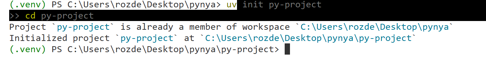


`.venv` не создаётся сразу при uv init. Он будет автоматически создан при первом запуске любой команды проекта, например uv run или uv sync . Это стандартное поведение uv для управления проектами.

Чтобы принудительно создать окружение прямо сейчас:

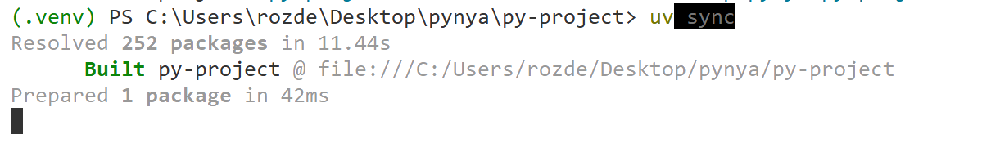

uv sync

# Добавление в toml зависимостей из requirements.txt

Эта команда добавит все пакеты из файла в секцию dependencies pyproject.toml, но такой способ добавит все в общие зависимости, никаких опциональных

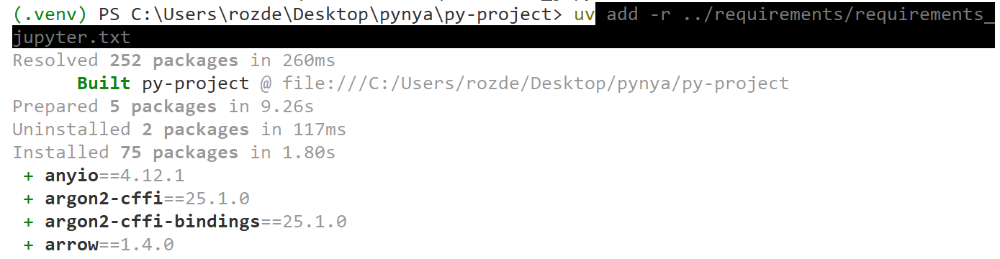
uv add -r requirements*.txt

Устанавливаем все опциональные зависимости (extras) из pyproject.toml
uv pip install -r pyproject.toml --all-extras
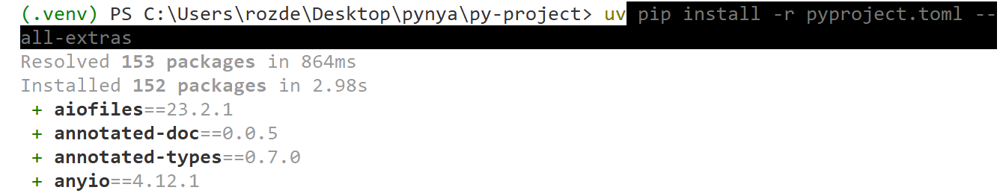