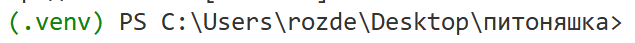
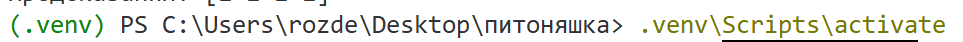
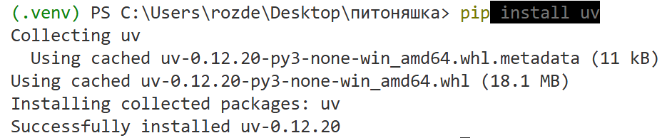
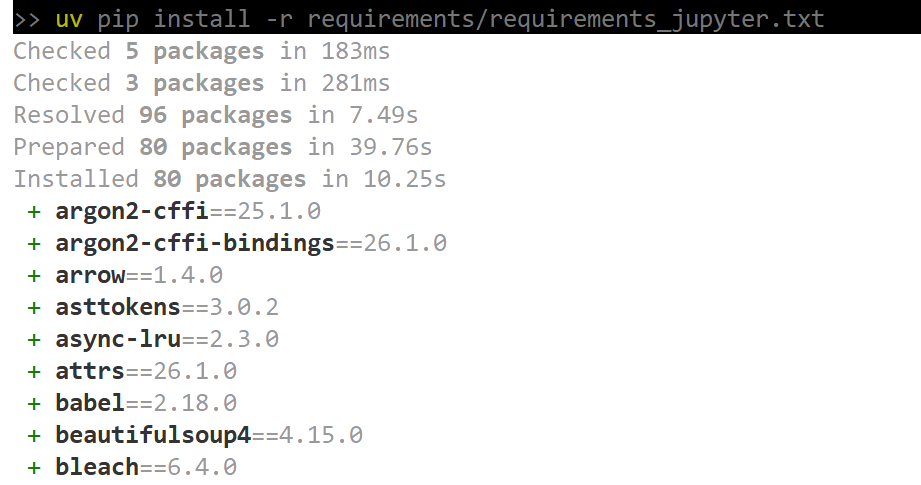
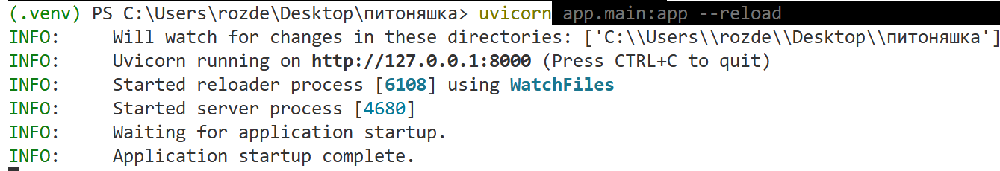

# ML Project

## Создание окружения
python -m venv .venv

## Активация скриптов

.venv\Scripts\activate

## Установка uv для более быстрой загрузки пакетов

pip install uv

## Установка зависимостей из заранее заготовленных файлов в папке requirements
uv pip install -r requirements/requirements_ML.txt
uv pip install -r requirements/requirements_service.txt
uv pip install -r requirements/requirements_jupyter.txt

запустится установка

после установки можно проверить

## Запуск приложения FastAPI
запуск:

приложение:

результат:
